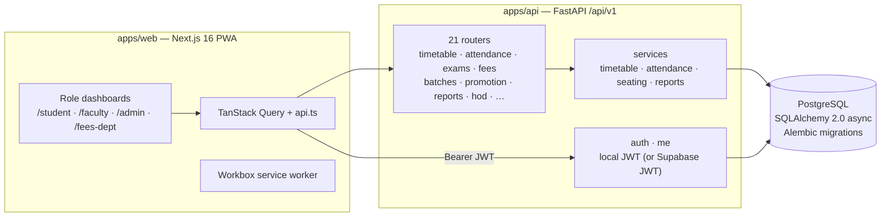

# CampusCore

**College management PWA for an Indian engineering college: timetables, lecture and activity attendance, exams, fees and academic records in one app for students, faculty, HODs and admins.**


[](LICENSE)

## Overview

The target college (5000+ students, 9 B.Tech branches, 500–1000 faculty) runs on paper attendance registers and printed Excel timetables. CampusCore replaces those with a single installable web app that every student and faculty member opens daily.

It is a pnpm monorepo with a **Next.js** PWA (`apps/web`) and an async **FastAPI + SQLAlchemy** backend (`apps/api`) over PostgreSQL. Development ran from April 18 to 23, 2026 across 39 commits. The core workflows (academic structure, timetables, attendance, exams, fees and leave) are implemented end to end against seed data. It has not been piloted with real users, and automated tests cover only the health endpoint.

## Contents

- [Highlights](#highlights)
- [Architecture](#architecture)
- [Modules](#modules)
- [Tech stack](#tech-stack)
- [Repository layout](#repository-layout)
- [Getting started](#getting-started)
- [Scripts](#scripts)
- [Roadmap](#roadmap)
- [License](#license)

## Highlights

- **Six roles** with role-specific dashboards: `student`, `faculty`, `hod`, `fees_department`, `admin`, `super_admin`.
- **Batch-first academic model**: batches (by graduation year) → divisions → subjects, with automatic year calculation and semester/year **promotion**.
- **Timetable workflow**: subject assignment → faculty assignment → period creation, with holidays and per-day period instances.
- **Attendance**: faculty mark lecture attendance per period; students see per-subject percentages; defaulter (<75%) lists and faculty-compliance reports.
- **Exam seating engine** (`services/seating.py`): one student per bench in exam mode, or two per bench from different branches/years in class-test mode.
- **Installable PWA** with a Workbox service worker and web manifest.
- **16 Alembic migrations**, 21 API routers (~140 endpoints) under `/api/v1`, and an `audit_log` table (the web `/admin/audit-log` page exists but its API endpoint is not implemented yet).
- **CI** (GitHub Actions): web lint, typecheck and build, plus API ruff, mypy, migrations against a Postgres 16 service and pytest.

## Architecture



Authentication runs in one of two modes (`apps/api/app/core/security.py`). By default the API issues its own HS256 JWTs (local mode). If `SUPABASE_JWT_SECRET` is set, it validates Supabase-issued tokens instead.

## Modules

| Area | Student | Faculty / HOD | Admin |
|---|---|---|---|
| Timetable | Weekly timetable | Today's classes, workload | Build timetables per batch/division |
| Attendance | Per-subject %, activity attendance requests | Mark lectures, edit, defaulter list, approvals | Section / below-75% / compliance reports |
| Exams & results | Exam schedule, results, re-evaluation requests | — | Exam setup + seating arrangement |
| Fees | Fee status | — | Fees-department role and dashboard |
| Academic | Profile, study materials, assignment submissions | Materials, assignments, dept students/faculty (HOD) | Departments, batches, divisions, subjects, promotion, bulk user import |
| Leave & calendar | Leave applications, calendar | Own leaves, faculty-leave approvals (HOD) | Academic calendar, notifications, audit-log view (UI only) |

<details>
<summary><b>Web routes</b> (54 pages under <code>apps/web/app</code>)</summary>

- **Student:** `/student`, `/student/timetable`, `/student/attendance`, `/student/attendance/[subjectId]`, `/student/activities`, `/student/exams`, `/student/results`, `/student/reeval`, `/student/fees`, `/student/materials`, `/student/submissions`, `/student/leaves`, `/student/calendar`, `/student/notifications`, `/student/profile`
- **Faculty / HOD:** `/faculty`, `/faculty/today`, `/faculty/classes`, `/faculty/classes/[classId]`, `/faculty/assignments`, `/faculty/materials`, `/faculty/defaulters`, `/faculty/approvals`, `/faculty/workload`, `/faculty/leaves`, `/faculty/my-leaves`, `/faculty/faculty-leaves`, `/faculty/dept-faculty`, `/faculty/dept-students`, `/faculty/calendar`, `/faculty/notifications`, `/faculty/profile`
- **Admin:** `/admin`, `/admin/academic`, `/admin/academic/new-semester`, `/admin/batches`, `/admin/batches/promote`, `/admin/batches/[batchId]/subjects`, `/admin/batches/[batchId]/divisions/[divisionId]`, `/admin/timetable`, `/admin/exams`, `/admin/calendar`, `/admin/users`, `/admin/users/import`, `/admin/reports`, `/admin/notifications`, `/admin/audit-log`
- **Fees department:** `/fees-dept`, `/fees-dept/notifications`
- **Shared:** `/` (landing), `/login`, `/change-password`, `/reset-password`, `/dashboard`

</details>

## Tech stack

| Layer | Tech |
|---|---|
| Frontend | Next.js 16 (App Router), React, TypeScript, Tailwind CSS, shadcn/ui, Framer Motion, TanStack Query, React Hook Form + Zod, Workbox |
| Backend | FastAPI, Pydantic v2, SQLAlchemy 2.0 (asyncpg), Alembic, python-jose, bcrypt |
| Database | PostgreSQL 15+ (local for dev; Supabase Postgres intended for staging/production) |
| Tooling | pnpm 10 workspaces, uv, ruff, mypy, pytest, Prettier, ESLint, GitHub Actions |

## Repository layout

```text
CampusCore/
├── apps/
│   ├── web/                    # Next.js PWA
│   │   ├── app/                # App Router pages: student/, faculty/, admin/, fees-dept/, login/ …
│   │   ├── components/         # app shell, sidebar, attendance ring, timetable modals, PWA register
│   │   ├── lib/                # api client, auth context, query hooks, Zod schemas
│   │   ├── public/             # manifest.webmanifest, sw.js, icons
│   │   └── .env.local.example
│   └── api/                    # FastAPI backend
│       ├── app/
│       │   ├── core/           # config, async DB session, auth/JWT
│       │   ├── models/         # SQLAlchemy models (users, academic, timetable, attendance, exam, fees, …)
│       │   ├── routers/        # 21 routers + dev-only seeding router (ENVIRONMENT=local)
│       │   ├── schemas/        # Pydantic schemas
│       │   └── services/       # timetable, attendance, seating, reports
│       ├── alembic/versions/   # 16 migrations
│       ├── scripts/            # seed_aids.py, seed_all_batches.py (synthetic demo data)
│       ├── tests/              # health-endpoint smoke test
│       ├── pyproject.toml / uv.lock
│       └── .env.example
├── .github/workflows/ci.yml
├── package.json · pnpm-workspace.yaml · pnpm-lock.yaml
├── .env.example
└── LICENSE
```

## Getting started

### Prerequisites

- Node.js 20+ and pnpm 10+
- Python 3.11+ and [uv](https://docs.astral.sh/uv/)
- PostgreSQL 15+ on `localhost:5432`

### First-time setup

```bash
git clone https://github.com/rupeshbharambe24/CampusCore.git
cd CampusCore
pnpm install                                   # frontend deps

psql -U postgres -c "CREATE DATABASE campuscore;"

cd apps/api
uv sync                                        # backend deps (runtime + dev)
cp .env.example .env                           # edit DB credentials if needed
uv run alembic upgrade head                    # create schema
uv run python scripts/seed_aids.py             # optional: AI & DS branch demo data
uv run python scripts/seed_all_batches.py      # optional: students for all four batches
cd ../..
```

The seed scripts create demo accounts with throwaway passwords that are printed to the console (e.g. `admin@campuscore.in`). Use them only locally.

### Run

```bash
# terminal 1 — API on http://localhost:8000 (Swagger at /api/v1/docs)
pnpm dev:api

# terminal 2 — web on http://localhost:3000
cp apps/web/.env.local.example apps/web/.env.local   # first time only
pnpm dev
```

## Scripts

From the repo root:

| Command | What it does |
|---|---|
| `pnpm dev` | Next.js dev server (`apps/web`) |
| `pnpm dev:api` | FastAPI dev server with reload (`apps/api`, via uv) |
| `pnpm build` | Production build of the web app |
| `pnpm lint` / `pnpm typecheck` | ESLint / `tsc --noEmit` across JS workspaces |
| `pnpm format` / `pnpm format:check` | Prettier |

Backend checks run from `apps/api`: `uv run pytest`, `uv run ruff check .`, `uv run mypy app` (see [apps/api/README.md](apps/api/README.md)).

## Roadmap

| Phase | Scope | State |
|---|---|---|
| 0 | Monorepo scaffold, CI, local DB | Done |
| 1 | Data model, auth, `/me` | Done (local JWT; Supabase mode supported but optional) |
| 2 | Academic structure, then a batch/division redesign with promotion | Done |
| 3 | Timetable management | Done |
| 4 | Lecture attendance | Done |
| 5 | Activity attendance + notifications | Done |
| 6 | Admin reports + PWA service worker | Done |
| — | HOD module, exams + seating, fees, study materials, assignments, re-evaluation, calendar, faculty leaves | Done |
| 7 | Hardening (tests, secret management, rate limiting) and a pilot | Not started |

Known gaps before any pilot: the test suite is a single smoke test, `/admin/audit-log` has no backend endpoint yet, the local-mode JWT secret is a hard-coded development default in `security.py`, and CORS was relaxed to allow all origins while debugging.

## License

MIT — see [LICENSE](LICENSE).
